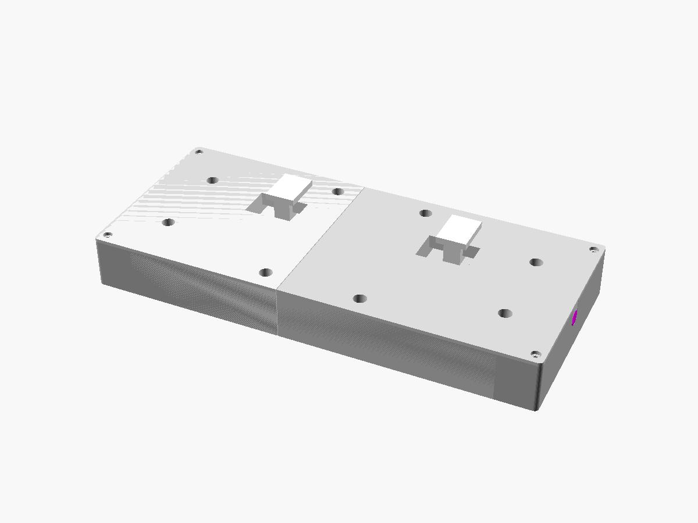
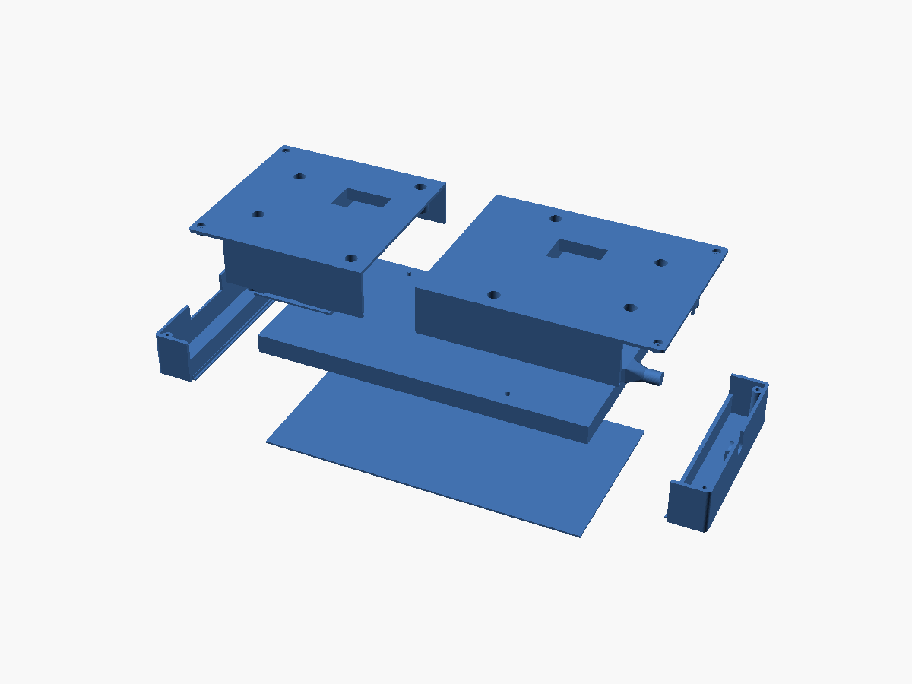
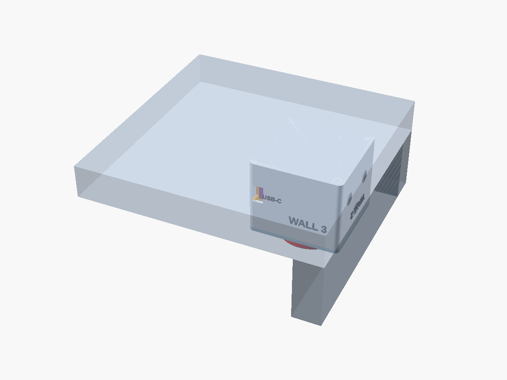

# Table Tennis Scoreboard

A wall-mounted 128x64 RGB LED scoreboard with a wireless arcade-button remote at each end of the table. Press the button at your end to score. It tracks serve, games, sides and per-player stats. The remotes need no switch: they sleep between games, wake on a press, charge over USB-C and show their battery level on the scoreboard.

This repository has everything needed to build one: firmware, 3D-printable parts, the parts list and the assembly steps.

| Scoreboard enclosure (back) | Enclosure parts | Remote under the table |
| --- | --- | --- |
|  |  |  |

**Status: V1.** Built, assembled and running. One thing is untested: hanging the scoreboard on its wall hooks.

## What's in this repository

    src/                               firmware
    ├── scoreboard/code.py             launcher for the Matrix Portal
    ├── remote/code.py                 launcher for a QT Py remote
    └── tt_scoreboard/                 shared package (copied to every board)
    tests/                             desktop tests for the game logic
    deploy.sh                          copies the firmware to a plugged-in board
    hardware/
    ├── stl/                           ready-to-print parts
    ├── adafruit-display-enclosure/    scoreboard enclosure: OpenSCAD source and design notes
    ├── adafruit-button-enclosure/     remote box: OpenSCAD source and design notes
    └── TOLERANCES.md                  fits measured on the author's printer

## Build overview

1. [Buy the parts](#parts-list). Check first that your table suits the remotes (see [Before you buy](#before-you-buy)).
2. [Print the enclosures](#printing).
3. [Install the firmware](#firmware) and test the boards on the bench.
4. [Assemble the scoreboard](#assemble-the-scoreboard) and [the two remotes](#assemble-the-remotes).
5. [Hang the scoreboard and mount the remotes](#mounting), then [play](#usage).

## Parts list

Prices and stock change, and several of these parts were out of stock when this was written, so check before ordering.

### Scoreboard

| Qty | Part | Adafruit ID |
| --- | --- | --- |
| 1 | 128x64 RGB LED Matrix Panel, 2 mm pitch (includes the power cable and a ribbon cable you won't need) | [6484](https://www.adafruit.com/product/6484) |
| 1 | Matrix Portal S3 | [5778](https://www.adafruit.com/product/5778) |
| 1 | 5 V 4 A regulated power adapter | [1466](https://www.adafruit.com/product/1466) |
| 1 | Female DC adapter, 2.1 mm jack to screw terminal | [368](https://www.adafruit.com/product/368) |
| 1 | USB-C data cable, to load the firmware | |
| 1 | Clear acrylic sheet, 10 × 8 in, 0.060 in (1.52 mm) thick | hardware store |
| 8 | M4 × 12 mm screws (panel to trays) | hardware store |
| 4 | M3 × 10 mm screws (wings to trays) | hardware store |
| 2 | 3M Command J-hooks, small (see the sizes in [Mounting](#mounting)) | store |
| 2 | Stick-on bumpers, about 5 mm tall (bottom of the back, against the wall) | store |
| | Short length of two-conductor wire rated for at least 4 A, from the jack to the Portal's terminals | |

### Remotes (the quantities are for both)

| Qty | Part | Adafruit ID |
| --- | --- | --- |
| 2 | QT Py ESP32-S3, either variant | [5426](https://www.adafruit.com/product/5426) or [5700](https://www.adafruit.com/product/5700) |
| 2 | Terminal Block BFF for QT Py | [6495](https://www.adafruit.com/product/6495) |
| 2 | MAX17048 fuel gauge | [5580](https://www.adafruit.com/product/5580) |
| 2 | LiPo battery, 3.7 V 500 mAh | [1578](https://www.adafruit.com/product/1578) |
| 2 | Large Arcade Button with LED, 60 mm (white is [1192](https://www.adafruit.com/product/1192), red is [1190](https://www.adafruit.com/product/1190)) | |
| 2 | STEMMA QT cable, 100 mm | [4210](https://www.adafruit.com/product/4210) |
| 2 | JST-PH 2-pin jumper cable, 100 mm | [4714](https://www.adafruit.com/product/4714) |
| 1 pack | Quick-connect wires, 0.25 in (10-pack; one pair per button) | [3838](https://www.adafruit.com/product/3838) |
| 6 | M3 × 10 mm screws (lids; 3 per box) | hardware store |
| 8 | M2.5 × 12 mm screws (boards to sleds; 4 per box) | hardware store |
| 12 | Disc magnets, 9.53 mm across × 1.53 mm, with adhesive foam (2.0 mm thick with the foam; 6 per box) | hardware store |

The scoreboard calls the remotes `BLUE` and `RED`. If your buttons are other colors, change `REMOTE_NAMES` and `REMOTE_COLORS` in `src/tt_scoreboard/screens.py`.

### Before you buy

The remote boxes are designed for one specific table. Each is held by magnets in the inside corner under the tabletop, against a **steel apron** about 48 mm tall. A box needs that corner to be clear, and without steel the magnets won't hold. For any other table, change the mount in the OpenSCAD design.

You'll also need a screwdriver, a sharp utility knife or acrylic scoring tool, a metal straightedge, and sandpaper.

## Printing

Everything prints in PLA with no supports. The STLs in `hardware/stl/` are already in their print orientation, so don't rotate them. The times below are from PrusaSlicer on a Prusa MK4S (0.4 mm High Flow nozzle, 0.20 mm SPEED profile, 15 % infill). The largest part is 175 × 135 mm.

| Print | File | Qty | Time | Filament |
| --- | --- | --- | --- | --- |
| Left tray (back face down) | `display-back-left.stl` | 1 | 1 h 49 m | 71 g |
| Right tray (back face down) | `display-back-right.stl` | 1 | 2 h 17 m | 90 g |
| Left wing (front face down) | `display-end-left.stl` | 1 | 51 m | 31 g |
| Right wing (front face down) | `display-end-right.stl` | 1 | 55 m | 32 g |
| Remote base (top face down) | `remote-base.stl` | 2 | 1 h 29 m | 53 g |
| Remote lid (outer face down) | `remote-lid.stl` | 2 | 20 m | 12 g |
| Remote board sled (flat, posts up) | `remote-sled.stl` | 2 | 15 m | 5 g |

**Print the fit tests first if your printer isn't an MK4S.** The fits were tuned on that printer ([`hardware/TOLERANCES.md`](hardware/TOLERANCES.md)):

| Fit test | File | Time | What it checks |
| --- | --- | --- | --- |
| Scoreboard coupon | `display-fit-coupon.stl` | 22 m | M4 and M3 screws, acrylic slot |
| Barrel-jack coupon | `display-jack-coupon.stl` | 30 m | the jack in its holder, with your real jack and plug |
| Remote fit test | `remote-fit-test.stl` | 50 m | button hole, pegs, board posts, magnets |

**Color:** the original scoreboard is white, from one spool so the parts match. White PLA lets a little light through, so edge LEDs can glow into the frame. The remotes are dark, to hide under the table.

**One thing that differs from the original build:** the left tray in `hardware/stl/` includes fixes found while building (hole positions, wing pads, cleaner counterbores). The right tray was printed and fitted in this form, and the left tray was not, so test its fit before you commit to all eight screws.

### Changing the designs

The STLs come from the `.scad` files, which need [OpenSCAD](https://openscad.org/) 2021.01 or newer and the [BOSL2](https://github.com/BelfrySCAD/BOSL2) library. Every setting is a named parameter at the top of the file, and `part` picks what to render. For example:

    openscad -o back_right.stl -D 'part="back_right"' hardware/adafruit-display-enclosure/enclosure.scad

Each design's `AGENTS.md` records the measurements and the reasons behind them. Its `collisions` part checks the printed parts against models of the real components. The remote's should come out empty; the scoreboard's shows only a thin strip where the Portal's model overlaps the wing's ledge, which is expected.

## Firmware

Firmware: CircuitPython 10.3.1 on every board. Library bundle: 10.x-mpy, release 20261003 (scoreboard only; the remotes use built-in modules).

CircuitPython only runs `code.py` from the root of CIRCUITPY, so each board gets its own small launcher plus the `tt_scoreboard` package.

### First-time setup

`deploy.sh` is written for Linux and needs `bash` and `rsync`. On another system, copy the files to the board by hand: the steps it follows are described under [Deploying](#deploying).

1. Install CircuitPython on each board with the installer on [circuitpython.org](https://circuitpython.org/downloads): Matrix Portal S3 for the scoreboard, and for each remote the QT Py ESP32-S3 variant you bought (no PSRAM, or 4 MB flash/2 MB PSRAM).
2. Download the 10.x-mpy [library bundle](https://circuitpython.org/libraries) and unzip it in the root of this repository, so that you have an `adafruit-circuitpython-bundle-10.x-mpy-*/` folder (ignored by git).
3. Optional: copy `players.example.txt` to `players.txt` and put in your players' names (see [Player names](#player-names)).
4. Plug in one board at a time and run the matching commands below. On the scoreboard, use `--libs` the first time.

### Deploying

Plug in one board at a time (or pass the mount point), then run:

    ./deploy.sh scoreboard              # Matrix Portal: copy the app
    ./deploy.sh scoreboard --libs       # ...and the libraries from the local bundle
    ./deploy.sh remote --side left      # QT Py remote for the left end of the table
    ./deploy.sh remote --side right     # QT Py remote for the right end
    ./deploy.sh remote --side left --dry-run  # preview without writing

The script finds the drive by reading `Board ID` in each mounted drive's `boot_out.txt`, so it refuses to put remote code on the Matrix Portal or vice versa. It mirrors `src/tt_scoreboard/` onto the board and copies that board's `code.py`. For remotes it also writes `TT_SIDE = "left"` (or `"right"`) to the board's `settings.toml`, keeping any other settings (and removing the old `TT_PLAYER` setting). Override the drive with a final argument or `$CIRCUITPY`.

### Player names

The names are kept out of the repository. Copy `players.example.txt` to `players.txt` (ignored by git) and list one name per line, 8 characters max. `./deploy.sh scoreboard` saves them on the board as `TT_PLAYERS = "NAME1,NAME2,..."` in its `settings.toml`; without a `players.txt` it leaves the board's names as they are. A board with no `TT_PLAYERS` shows `PLAYER 1` to `PLAYER 4`.

### Panel colors

This panel has its red and blue data lines swapped, so the scoreboard sets the matrix's color order to `BGR` (`MATRIX_COLOR_ORDER` in `src/tt_scoreboard/app.py`). If colors look wrong on a replacement panel (red shows as blue, for example), try `"RGB"` or another order.

## Assemble the scoreboard

Directions below are **seen from the back of the panel, with the Matrix Portal on the left**. The back faces you while you build, so from the front the Portal is on the right. Test the board and the panel on the bench first.

### Wire the power

1. Plug the panel's power cable into the panel and screw its fork ends to the Matrix Portal's power terminals.
2. Wire the jack's screw terminals to those same Portal terminals, **+ to + and − to −**. The one 5 V adapter then runs both the panel and the Portal. Leave enough wire to reach the right end of the enclosure.
3. Plug the Matrix Portal into the panel's HUB75 **input** socket, so its USB-C end sticks out past the panel's left edge.

Check polarity with a meter before you plug in the adapter. A reversed or wrong-voltage supply can destroy the panel. Before leaving the adapter and a USB-C cable connected at once, check Adafruit's Matrix Portal S3 guide.

### Put it in the enclosure

The left and right trays carry the panel and the hook pockets, and the wings close the ends. The wings go on last, because the Portal sticks out past the panel.

1. Set the jack into the cradle in the right tray, nose pointing out the right end, wires leaving to the left.
2. Lay the trays on their back faces, side by side, and lower the panel in, LED side up, so the Portal sits at the left. The trays only meet at the seam, and the panel holds them together.
3. Holding it all together, turn it over and fix the trays to the panel with **8 × M4 × 12** screws through the back. Don't overtighten; they go into threaded holes in the panel.
4. Fit the left wing so the Portal's edge sits in its window, with the USB-C and buttons reachable. Fit the right wing so its saddle sits under the jack's nose. Fix each wing with **2 × M3 × 10** screws from the back. The screws cut their own threads in the plastic, so they're very tight at first.

### Cut and fit the front sheet

The sheet slides in from the top, so leave the protective film on until the end.

1. **Test the length first.** Slide the uncut sheet in from the top, pressed toward the front lips so it doesn't drag on the LEDs. It should have about 0.5 mm of total play between the stops in the wings (they're about 253.5 mm apart in the model). If it jams or is snug, sand the short end on a flat block. You have up to about 3 mm to spare before an end comes out from behind a lip.
2. **Measure the height.** With the sheet seated in the bottom groove, measure from its bottom edge to the top of the frame. On the original it's about 133.1 mm.
3. **Score and snap.** Measure that height from a factory edge, and add about 0.5 mm. Clamp a metal straightedge over the part you're keeping, and make 8–10 light passes with the scoring tool. Then line the score up with a table edge, clamp a board along it, and press the offcut down evenly.
4. **Finish.** The snapped edge goes **down**, hidden in the groove, and the factory edge stays on top. Sand the snapped edge until the top is flush with the frame, or slightly under, and scrape off any ridge so it can't bind in the groove. Round the bottom corners a little.
5. Peel the film and slide the sheet in. Clean it with mild soapy water and a microfiber cloth, not window cleaner or alcohol, which can cause fine cracks.

The sheet is a little shorter than the panel, so the wing lips cover the outermost LED column on each side.

## Assemble the remotes

Build two. **Wall 1–4** and the other names are defined in [the remote's design notes](hardware/adafruit-button-enclosure/AGENTS.md). Test each remote on the bench before closing it (see [Remotes](#remotes) for how a remote behaves).

Connect the arcade button's **switch** terminals (the two on the switch body, not the LED terminals) to the Terminal Block BFF with the quick-connect wires. Cut off the wires' white 2-pin plug, and strip about 5 mm:

- one switch terminal to **RX** (GPIO 16, which can wake the board from deep sleep)
- the other switch terminal to **GND**

The pin uses the internal pull-up, so no resistor is needed. The button's LED is not used.

The battery runs through the MAX17048 fuel gauge, which measures its charge:

- the LiPo into either of the gauge's two JST-PH ports
- the JST-PH jumper from the gauge's other JST-PH port to the Terminal Block BFF's battery connector
- the 100 mm STEMMA QT cable from the gauge to the **QT Py's own** STEMMA QT port (the firmware reads the gauge there, on `SCL1`/`SDA1`, not on the BFF's port)

Check that red goes to + at every battery connector.

The BFF charges the battery whenever the QT Py is on USB: its orange CHG LED is lit while charging and the green DONE LED when the battery is full. The gauge is powered by the battery itself, so it keeps tracking the charge while the QT Py sleeps. The remote works without the gauge; it just reports no charge.

Then put it in the box, in this order:

1. **Screw the button wires into the terminals before anything else**: once the BFF is on the sled, its terminal screws can't be reached. Leave the wires about 120 mm long, and trim them after a dry fit.
2. Screw the BFF onto the sled's posts with **4 × M2.5 × 12** screws. Plug the QT Py into the BFF.
3. Stick **6 magnets** into the pockets in the outside of Walls 1 and 2, foam side into the pocket.
4. Slide the gauge between the two ribs on Wall 1, and stand the battery on edge between Wall 2 and its two ribs.
5. Slide the sled in along Wall 4, with its far edge in the groove in Wall 3. The USB-C port lines up with the opening in Wall 3.
6. Put the button through the lid with its pegs in the slots, so the switch tabs point at the corner between Wall 2 and Wall 3. Tighten the nut.
7. Push the spades onto the switch (COM and NO if it has three tabs; polarity doesn't matter). Keep the wires clear of the switch plunger, and close the lid with **3 × M3 × 10** screws.

Charging cables need a plug no bigger than about 12.5 × 7 mm, and one that reaches about 7.6 mm into the box.

## Mounting

**The scoreboard** hangs on two 3M Command J-hooks stuck to the wall. The design used hooks that reach 20 mm from the wall to the J tip, with a J 4.8 mm thick and a base 21.3 × 30 mm and 4.5 mm thick. Other sizes may not fit the pockets.

*This hasn't been tried on a wall yet, so test it with care, and check that the hooks' weight rating covers the whole scoreboard before you trust it.*

1. Stick the hooks **126.5 mm apart, center to center**, and level. The pockets are 36 mm wide, so a few millimeters off is fine.
2. Stick two bumpers (about 5 mm tall) on the bottom of the back, so the enclosure hangs parallel to the wall.
3. To hang: hold the scoreboard about 20 mm high, push it back so the hooks enter the pockets, and lower it. To remove: lift it about 20 mm and pull. It can't come off without being lifted.

The bottom of the enclosure ends up about 97 mm below the inside bend of the hooks. Follow 3M's instructions for the adhesive strips.

The power jack is on one end and the USB-C and Portal buttons on the other, and both stay reachable while it's hung.

**The remotes** go in the inside corner under the tabletop, at each player's left corner, button pointing at the floor. Wall 1 sits against the end apron and Wall 2 against the side apron. Pressing the button pushes the box into the tabletop, so the magnets only carry its weight. Pull it down to remove it.

## Remotes

### Behavior

- A remote belongs to an end of the table, not to a player, so it can stay mounted while players change ends. A press scores for whoever is at that end.
- On power-up or wake, the QT Py's NeoPixel blinks **blue once for the left side, twice for the right**. Ten fast **red** blinks mean `TT_SIDE` is missing; redeploy with `--side`.
- Each press is broadcast over **ESP-NOW** (no Wi-Fi network needed) and behaves exactly like that side's onboard button: tap, double-tap and hold all work.
- On power-up or wake, and with every press, the remote reports its battery charge (read every minute while awake).
- After 10 minutes without a press the remote goes into deep sleep. **The next press only wakes it** (watch for the blue blink); it is not sent to the scoreboard. On USB, CircuitPython only simulates deep sleep, unless the remote woke from a real deep sleep: then it sleeps for real and drops off USB until the next press.

### Battery life

The Wi-Fi radio is the biggest drain, so it is only on while the remote is sending: it switches on when the button is pressed or released and off 100 ms after the last packet (it stays on while the button is held, for the heartbeats). Restarting it takes about 4 ms, so presses aren't noticeably delayed. The processor runs at 80 MHz instead of 240 MHz.

### Radio notes

The scoreboard and the remotes must run the same version of the wireless protocol (`_VERSION` in `remote_link.py`): after updating it, deploy the scoreboard and both remotes, or the scoreboard ignores the remotes.

ESP-NOW requires the scoreboard and remotes to be on the same Wi-Fi channel. Neither joins a Wi-Fi network, so they stay on the default channel. Don't set up Wi-Fi (`CIRCUITPY_WIFI_SSID`) on the scoreboard, or it moves to the router's channel and stops hearing the remotes.

Set `REMOTES_ENABLED = False` in `src/tt_scoreboard/app.py` to turn off the radio on the scoreboard.

## Usage

The onboard UP and DOWN buttons on the Matrix Portal always work too: UP is the left side and DOWN is the right side.

On the name screen the headers show each remote by its button color, `BLUE` for the left end and `RED` for the right, with its battery charge, such as `BLUE 87%` and `RED 18%`. The charge is green from 50%, yellow from 20% and red below. `BLUE --` means that remote hasn't reported since the scoreboard started; press its button once. Change `REMOTE_NAMES` and `REMOTE_COLORS` in `screens.py` if the buttons are swapped. With `REMOTES_ENABLED = False` the headers read `PLAYER 1` and `PLAYER 2`.

1. **Name selection**: the left button picks player 1 (who starts at the left end) and the right button player 2. Tap for the next name, double-tap for the previous name, and hold for 1 second to lock in a name (hold again to unlock). Names are listed most recently played first, and after a match both cursors start on the players who just played, each at the end they finished at. Resting on a name for a second replaces `HOLD=LOCK` with that player's rank, record and win rate (shortened to fit). A name locked by one player is skipped for the other, except `GUEST`, which both players can pick; two guests appear as `GUEST 1` and `GUEST 2`. The last entry, `STATS` (in purple), is a menu item: hold on it to browse the stats. See [Player names](#player-names) to change the list.
2. **Serve**: tap your button to serve first; the serve bars appear around your name. Either player can tap to change it. The line below shows the match length: double-tap either button to switch between `BEST OF 7` and `BEST OF 5`. The board starts on best of 7 and keeps the last choice for the next match until it restarts (change `BEST_OF_CHOICES` and `DEFAULT_BEST_OF` in `app.py` for other lengths). Once someone is chosen, hold either button for 1 second to start the match.
3. **Match**: press the button at your end of the table to award yourself a point. The match is best of 7 (first to 4 games) or best of 5 (first to 3), as chosen on the serve screen. Players change ends after every game, and in the deciding game (3-3 in best of 7, 2-2 in best of 5) when someone reaches 5 points; the display swaps names, scores and game counts at the same moment, so each half of the board always shows the player at that end. The switch in the deciding game is easy to forget, so there the board shows `SWITCH SIDES` until either button is tapped, then the swapped scoreboard. A double tap on `SWITCH SIDES` undoes the point that caused it instead (if it was scored by mistake), so nobody has to move. The message also appears if an undo takes the deciding game back below 5 points, since the players then return to their previous ends.
   - **Undo**: double-tap either button to undo the last point. Repeat to step further back, even into the previous game (sides switch back too). Because a tap has to wait to see if a second tap follows, each point appears about 0.3 s after the press.
4. **Winner**: the match winner is shown until either button is held for 1 second or 30 seconds pass, then the board returns to name selection. Single taps do nothing, so a double tap that registers as one tap can't skip the screen. If the winning point was a mistake, double-tap either button (any time before the board moves on) to undo it and return to the match. Then the winner's and the loser's updated stats cards show for 5 seconds each (any press skips).

## Stats

Every match is recorded when its winner screen is confirmed, so an undone winning point never counts. Guests are not tracked; a named player's match against a guest still counts for them.

- **Leaderboard**: 4 players per page with their match record and match win rate. Players are ranked by `(wins + 2) / (matches + 4)`, as if everyone started with 2 extra wins and 2 extra losses, so one lucky win can't hold first place; ties go to the better game win rate. Players with no matches, and inactive players who haven't played in the last 30 matches, are hidden; their stats are kept, and they return as soon as they play again.
- **Player card**: match and game records with win rates, leaderboard rank and matches played.

Getting there:

- Hold on `STATS` in the name list to browse: tap for the next page, double-tap for the previous one, hold to go back (it also goes back after a minute untouched).
- After a minute untouched, the name screen cycles through the leaderboard and every card by itself. The first press goes back to the name screen, keeping any names already picked.

Reset: hold both buttons for 5 seconds on any stats screen (two people, or the board's UP and DOWN buttons), then hold both again for 3 seconds to confirm. Any other press cancels.

Stats are kept in the board's non-volatile memory, not on the CIRCUITPY drive, so deploying never touches them. They're stored by name: a player removed from `players.txt` is hidden, and their stats return if the name is added back.

## Crashes

If the scoreboard program crashes, it saves a report (how long it had been running and the error's traceback) at the end of the board's non-volatile memory, beside the stats. The report survives the reset button and unplugging, and a new crash replaces it. The board then shows `ERROR` / `RESTARTING` for 5 seconds and restarts by itself; the match in progress is lost, but recorded stats are not.

A crash within a minute of starting (a bad `players.txt` name, for example) is saved too, but the board stops instead of restarting over and over: the matrix goes black and the status light blinks red, as before.

To read the report, plug the scoreboard into a computer and open its serial console (for example `tio /dev/ttyACM0`, or Thonny or the Mu editor). It's printed every time the program starts, after `Last crash (saved in non-volatile memory):`; the console usually connects too late to catch that, so press Ctrl-C and then Ctrl-D to restart the program and see it. Or from the REPL (Ctrl-C):

    import microcontroller
    from tt_scoreboard.crash_log import CrashLog
    print(CrashLog(microcontroller.nvm).load())
    CrashLog(microcontroller.nvm).clear()  # forget it

## Tests

The logic in `src/tt_scoreboard/` that doesn't touch hardware (`scoring.py`, `name_selection.py`, `gestures.py`, `remote_link.py`, `stats.py`, `crash_log.py`) can be tested on desktop Python:

    python3 -m unittest discover -s tests -t .

## License

Released under the [MIT License](LICENSE): the firmware and the 3D designs are free for anyone to use, copy, modify and share.
